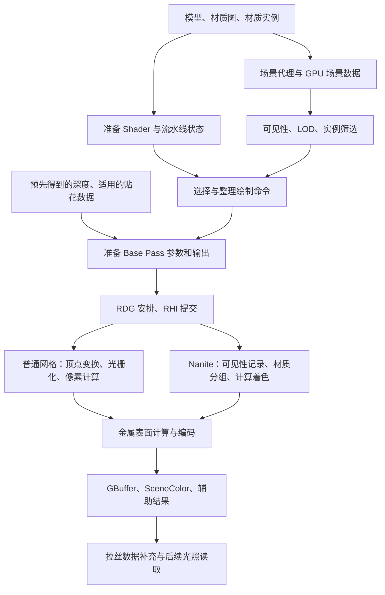

# 从一块金属看懂 UE Base Pass：给 Rendering TA 的源码学习地图

**金属模型与材质实例 → 预先生成并编译 Shader → 渲染侧接收模型、材质和相机数据 → 筛选这一帧可见的网格与实例 → 选择 Base Pass 的 Shader 和绘制状态 → 整理、缓存、排序绘制命令 → 准备输出纹理与共享参数 → RDG 安排资源和执行任务 → RHI 提交 GPU 命令 → 顶点变换 → 三角形覆盖屏幕并插值 → 深度筛选 → 读取贴图并计算金属表面属性 → 构造 Toon 表面数据 → 编码并写出 GBuffer 与场景颜色 → 补充拉丝方向数据 → 后续灯光和反射读取这些结果。**

读完这份文档，你应当能沿着一个金属表面的位置，说清它的模型数据、材质参数、贴图数值怎样变成屏幕空间的表面记录；也能从每个环节找到相应源码入口。

本文按 2026-10-12 的项目配置、本机 UE 5.8.2 源码和当前金属材质手册追查。材质主角是 `M_TV_ToonMetal_Master`。全文中的装甲、像素位置和数值用于演示计算；本次交付是源码架构学习文档，没有运行抓帧或性能测量。源码与材料文件的 SHA-256 记录在同目录的 `BASE_PASS_来源清单.json`。

## 阅读路线

第一次先读第 1、2、9、10、11、12 节，理解 Base Pass 的任务与输入输出；第二次按第 3～8 节补 CPU 组织和命令提交；第三次读第 13～17 节，接入 Nanite、GPU 执行和源码阅读方法。

- [1. Base Pass 到底完成什么](#1-base-pass-到底完成什么)
- [2. 先给架构分层](#2-先给架构分层)
- [3. 程序准备：材质图变成 Shader](#3-程序准备材质图变成-shader)
- [4. 场景入口：模型怎样进入渲染侧](#4-场景入口模型怎样进入渲染侧)
- [5. 本帧选择：谁需要被画](#5-本帧选择谁需要被画)
- [6. 绘制命令：选程序、绑数据、定规则](#6-绘制命令选程序绑数据定规则)
- [7. 输出与共享参数：准备工作台](#7-输出与共享参数准备工作台)
- [8. RDG、RHI 与 DX12：任务怎样交给 GPU](#8-rdgrhi-与-dx12任务怎样交给-gpu)
- [9. 顶点、光栅化与深度](#9-顶点光栅化与深度)
- [10. 材质计算：贴图怎样变成金属表面属性](#10-材质计算贴图怎样变成金属表面属性)
- [11. Substrate 与 GBuffer：表面信息怎样写出](#11-substrate-与-gbuffer表面信息怎样写出)
- [12. Base Pass 结束时交出了什么](#12-base-pass-结束时交出了什么)
- [13. Nanite 的另一条入口](#13-nanite-的另一条入口)
- [14. GPU 为什么会慢](#14-gpu-为什么会慢)
- [15. 一个位置的完整演示](#15-一个位置的完整演示)
- [16. 怎样一点点追源码](#16-怎样一点点追源码)
- [17. 自定义 Pass 与这张架构地图的关系](#17-自定义-pass-与这张架构地图的关系)
- [附录 A. 源码导航](#附录-a源码导航)
- [附录 B. 名词速查](#附录-b名词速查)

## 1. Base Pass 到底完成什么

**Base Pass 的主任务，是把相机看见的表面整理成后续渲染可以读取的数据。**

相机前有一块金属装甲。模型告诉引擎装甲的形状，材质告诉引擎各处的底色、粗糙度与金属度。Base Pass 把这两种信息结合起来，在屏幕的每个可见位置记录“这里是什么表面”。

| 工作 | 输入 | 输出 |
|---|---|---|
| 确定几何覆盖 | 顶点、三角形、模型变换、相机 | 屏幕上覆盖的位置和深度 |
| 求表面属性 | UV、法线、贴图、实例参数 | 底色、粗糙度、金属度、最终法线等 |
| 保存表面记录 | 算出的属性、Toon 数据 | GBuffer |
| 写入当前可用的颜色贡献 | 自发光及适用的预计算光照等 | SceneColor |
| 写辅助结果 | 当前与历史位置、绘制状态 | 适用的运动数据和深度模板标记 |

**GBuffer** 是几张按屏幕位置排列的纹理。你可以把它看成“屏幕表面登记表”：每个位置有一份材料和朝向记录。**SceneColor** 是场景颜色纹理，后续光照会继续向它累积结果。

你的项目启用了 Lumen，关闭静态光照，并使用 Substrate 的可混合 GBuffer。这个金属例子的直接灯光高光、Toon 明暗曲线和环境反射，主要由后续阶段根据表面登记表计算。

所以，一个金属位置在 Base Pass 后，已经有金属度与粗糙度等记录，随后才逐步获得灯光与环境提供的颜色。

## 2. 先给架构分层

Base Pass 同时涉及“准备程序”“安排本帧任务”和“执行任务”。把它们分开，你读源码时就不会把编译和绘制混在一起。



图里的 **LOD** 是模型的细节级别：远处用更简化的形状，减少几何工作。**RDG** 是渲染依赖图，管理任务与资源的关系。**RHI** 是 UE 的图形接口层，把引擎命令交给 DX12 等后端。

还有三个常见的“Pass”含义：

| 源码里看到的概念 | 人话解释 | 金属例子 |
|---|---|---|
| `EMeshPass::BasePass` | 给网格绘制分类的名单 | 这些网格需要参加 Base Pass |
| RDG Pass | 记录一项资源操作与执行任务 | `BasePassParallel`、`ShadeGBufferCS` |
| GPU 图形接口的 Render Pass | 一段使用指定输出附件的绘制范围 | 绑定 GBuffer 与深度进行绘制 |

**一个 Base Pass 阶段可以包含多个 RDG 任务、很多次绘制和多个 Shader。**读源码时，先确认自己看到的是哪一层。

## 3. 程序准备：材质图变成 Shader

### 3.1 节点图怎样变成代码

材质图定义了表面属性的计算关系。例如底色图乘一个颜色参数，就是采样和乘法；金属区域遮罩，就是一组相乘的数据。

**Shader** 是 GPU 上运行的程序。**HLSL** 是编写这类程序的语言。UE 把材质节点变成 HLSL，再放进对应阶段的程序框架。

```text
材质节点与材质函数
→ 翻译节点计算及相互依赖
→ 填入 MaterialTemplate.ush 的代码位置
→ 与 BasePassVertexShader.usf / BasePassPixelShader.usf 等框架组合
→ 根据材质、网格类型和平台生成需要的版本
→ Shader 编译任务生成 DXIL
→ 驱动准备当前 GPU 的执行程序
```

**DXIL** 是 DirectX 使用的中间程序表示。驱动会为具体 GPU 处理它；缓存与流水线预准备让后续绘制能够重复使用这些程序。[微软 DXIL 说明](https://github.com/Microsoft/DirectXShaderCompiler/blob/main/docs/DXIL.rst)

源码入口从 `UMaterialExpressionSubstrateToonBSDF::Compile` 到 `FHLSLMaterialTranslator::SubstrateToonBSDF`。后者生成对 `GetSubstrateToonBSDF(...)` 的调用，把你的金属输入装进 Toon 表面描述。

`MaterialTemplate.ush` 中可以看到 `%{calc_pixel_material_inputs_normal}` 等占位符。它们是生成材质代码的落点。打开这个模板，能理解框架；查看某个材质生成的 HLSL，才能看到那张具体材质图被填成的代码。

### 3.2 为什么一个材质会有多个 Shader 版本

决定 Base Pass 程序的因素包括：

| 因素 | 为什么会影响程序 |
|---|---|
| 材质本身 | 需要哪些纹理读取、属性计算与着色类型 |
| Vertex Factory，顶点数据适配器 | 静态模型、骨骼模型和实例模型读取顶点的方法不同 |
| 光照策略 | 是否需要读取预计算光照等数据 |
| 平台与功能配置 | DX12、Substrate 格式、输出布局等改变程序内容 |
| 绘制阶段 | 记录深度、写表面属性、写拉丝数据各自需要不同结果 |

这些变体常叫 **Permutation，程序变体**。`GetBasePassShaders` 按当前组合从材质已有的 Shader 集合中取出需要的版本。

在本项目配置中，静态光照关闭，普通示例采用 `LMP_NO_LIGHTMAP` 路径。这个名字表示“没有光照贴图的策略”。Lumen 的后续间接光依然正常参与整帧。

### 3.3 参数值与程序结构

`RoughnessMultiplier` 这样的普通标量，可以由材质实例提供。改变它，通常改变的是 Shader 读取的数据。静态开关则参与编译选择，可以产生另一份程序。

这里有一个与你的金属直接相关的区别：把 `HoyoSphereBlendStrength` 调成 0，数值上得到“保留原底色”；实际编译程序是否省掉球面贴图读取，要看生成代码和编译结果。普通参数的当前数值，与编译时能够固定消除的代码，是两件不同的事情。

**本节学习目标：能解释某个金属参数是程序中的数据，还是选择程序结构的条件。**

### 3.4 编译任务、Shader Map 与缓存

**Shader Map，着色器集合**，保存这个材质在相应平台和条件下的程序版本。绘制时的 `GetBasePassShaders` 从这里取程序。

`FMaterialShaderMap::Compile` 组织编译任务，Shader 编译管理器安排并接收结果。常见的 **ShaderCompileWorker** 是执行编译工作的进程，让多项编译可以并行推进。

**DDC，派生数据缓存**，保存能够从源数据重新生成的结果。材质与编译条件相同时，可以复用缓存结果。它与第 5 节的绘制命令缓存分别保存“编译产物”和“绘制安排”。PSO 缓存则保存流水线相关产物。

于是，第一次准备程序、更新材质后的重新编译和正常每帧绘制，各自有明确位置。源码中可以沿 `FShaderCompilingManager::ProcessAsyncResults` 看编译结果怎样回到引擎。

## 4. 场景入口：模型怎样进入渲染侧

### 4.1 游戏里的对象怎样交给渲染器

游戏侧有 Actor、网格组件和材质实例。渲染侧主要使用用于绘制的表示。

```text
网格组件
→ 创建渲染侧代理
→ 注册到渲染场景
→ 提供模型的各段网格、材质和顶点适配器
→ 生成可用于不同阶段的网格描述
```

**Scene Proxy，场景代理**，保存渲染需要的信息，并提供网格。`FPrimitiveSceneProxy` 是这里的重要接口。**Primitive** 在此表示渲染场景里的一个物体单位；它可以包含很多三角形。

普通静态网格的具体实现可从 `StaticMeshSceneProxy.cpp` 的 `DrawStaticElements` 与 `GetMeshElement` 追起：前者提供静态绘制描述，后者组织具体网格段的数据。

**`FMeshBatch`，网格批次描述**，告诉渲染器“这一段网格怎样画”。主要包括：

- 哪个 Vertex Factory 提供顶点数据；
- 哪个 Material Render Proxy 提供材质；
- 使用哪个索引范围、多少三角形和实例；
- 这段网格参与哪些渲染用途。

一套装甲可以同时包含金属和布料。网格按不同材质段提供批次，Base Pass 分别处理这些批次。材质槽在资产层把材质绑定到网格段；渲染时具体绘制依赖这段网格的材质引用。

### 4.2 GPUScene 与材质数据

**GPUScene，GPU 场景数据系统**，把物体和实例的信息整理成 GPU 能读取的数据。例如模型变换、物体标识、实例信息及自定义数据。Shader 使用相应标识找到自己正在处理的物体。

`GPUScene.cpp` 的 `Update`、`UpdateInternal` 与上传路径处理这些数据的更新。场景数据准备好之后，顶点适配器和材质参数读取逻辑才能找到当前物体的数据。

**Material Render Proxy，材质渲染代理**，负责在渲染侧提供材质资源与参数。材质实例的有效值包括父材质提供的值和实例覆盖的值。

**Uniform Buffer，共享参数缓冲**，是一次绘制或一组工作共同使用的参数包。例如同一个金属实例的 `BaseColorTint`，很多像素都会读取同一个值；每个像素的 UV 则随位置变化。

你可以按四个尺度记数据：

| 尺度 | 例子 | 谁需要它 |
|---|---|---|
| 每视图 | 相机矩阵、屏幕尺寸 | 这个相机的绘制 |
| 每物体／实例 | 模型变换、实例标识 | 当前物体的顶点与像素 |
| 每材质 | 贴图资源、底色染色、粗糙度倍率 | 使用这个材质的表面计算 |
| 每顶点／像素 | 顶点位置、UV、插值后的法线 | 当前这次 Shader 工作 |

**本节学习目标：说清同一材质画在两块不同位置的装甲上时，哪些数据共用、哪些数据不同。**

## 5. 本帧选择：谁需要被画

渲染器为当前相机建立 `FViewInfo`，也就是本视图的渲染信息。随后判断物体是否在相机范围里、是否被遮挡、使用哪个 LOD，以及需要参加哪些阶段。

`SceneVisibility.cpp` 中的 `ComputeRelevance` 判断物体与视图、阶段的关系。可见的静态网格会把相应命令加入 Base Pass 名单；动态网格通过 `ComputeDynamicMeshRelevance` 等路径分配到阶段。

**Relevance，相关性**，在这里可以理解为“这个物体需要参加当前视图的什么工作”。一个金属物体可能同时参加深度、Base Pass、阴影和拉丝数据阶段。

### 5.1 缓存路线与动态路线

```text
可以缓存的网格描述 → 提前构建绘制命令 → 本帧挑选可见命令
需要动态提供的网格描述 → 本帧收集 → 构建或组织本帧绘制命令
```

**缓存绘制命令**是在合适的时机把较稳定的设置整理好，后续帧重复使用。每帧仍需要处理可见性与更新变化的数据。UE 官方的网格绘制架构也按这个思路组织。[Epic 网格绘制文档](https://dev.epicgames.com/documentation/en-us/unreal-engine/mesh-drawing-pipeline-in-unreal-engine)

这里的“静态／动态网格描述路线”，描述的是渲染器怎样取得绘制信息。物体是否会移动、组件的 Mobility 设置、是否能缓存某项命令，是需要分别追查的条件。

### 5.2 实例筛选

假设同一块金属零件被放置 100 次，渲染器可以用实例数据表达这些副本。**Instance Culling，实例筛选**，进一步找出需要绘制的实例，并生成相应的绘制参数。

`FParallelMeshDrawCommandPass::BuildRenderingCommands` 会连接到实例筛选上下文，使用 GPUScene，并得到 `FInstanceCullingDrawParams`。

其中的 **Indirect Args，间接参数**，把数量等绘制参数存进 GPU 可读取的缓冲。这样绘制命令可以读取筛选后的数量。

**本节学习目标：看到装甲没被绘制时，能先检查它有没有进入 Base Pass 名单。**

## 6. 绘制命令：选程序、绑数据、定规则

### 6.1 Base Pass 的网格处理器

`FBasePassMeshProcessor` 把通用的 `FMeshBatch` 整理成适合 Base Pass 的命令：

```text
AddMeshBatch
→ 取得有效材质和 Shader 集合
→ TryAddMeshBatch 判断当前批次与阶段是否匹配
→ 选择光照策略及填充、剔除规则
→ Process 选择 Base Pass Shader
→ 设置深度、模板及排序信息
→ BuildMeshDrawCommands
```

**`FMeshDrawCommand`，网格绘制命令**，保存执行绘制需要的设置：程序、顶点流、资源绑定、绘制数量、状态等。你可以把它理解为一张准备好交给 GPU 的绘制工单。

主角材质是不透明表面，因此进入不透明 Base Pass 路线。透明材质和镂空材质会触发各自的筛选、输出或丢弃像素规则；这些是你之后看同一文件里的分支时会遇到的情况。

### 6.2 深度、模板、剔除与混合分别控制什么

| 状态 | 它控制什么 | 金属例子 |
|---|---|---|
| Depth，深度 | 前后比较与是否写深度 | 装甲后面的表面是否通过 |
| Stencil，模板 | 附着在深度图上的小标记及测试 | 记录接收贴花、光照通道等信息 |
| Cull，面剔除 | 是否跳过某一朝向的三角形 | 单面装甲通常剔除背面 |
| Fill，填充模式 | 实体填充还是线框 | 正常显示实体表面 |
| Blend，混合 | 新输出怎样与已有数据组合 | 不透明 GBuffer 通常写入当前表面值 |
| Write Mask，写入掩码 | 输出哪些通道 | 只更新所需附件的通道 |

这里的模板标记是主深度模板附件上的渲染器数据；角色描边常使用的 Custom Depth / Custom Stencil 属于另一套用途与资源。

UE 桌面深度通常采用 **Reverse Z，反向深度**：靠近相机的数值较大。因此源码里的 `CF_DepthNearOrEqual` 应理解为“更近或相同的表面通过”，再结合具体平台比较方式阅读。

### 6.3 PSO 与资源绑定

**PSO，流水线状态对象**，把 Shader、顶点输入方式、输出格式、深度与混合等设置组合起来。它告诉 GPU 这次绘制采用什么规则。

**资源绑定**则告诉 GPU 具体读取哪张纹理、哪包参数、哪块顶点数据。PSO 是规则组合，绑定是本次使用的数据。

### 6.4 排序、合批与 CPU 并行

命令会按排序键整理，尽量减少状态与程序切换，并配合可见性、深度等条件。相容的实例可以合并，减少重复提交。

`BasePassParallel` 中的 Parallel 主要涉及 CPU 并行录制绘制命令：多个工作线程分别整理命令列表。GPU 怎样并行执行，要继续看提交和硬件执行层。

**本节学习目标：能沿一条绘制工单找到“使用哪个程序、读什么数据、按什么规则写到哪里”。**

## 7. 输出与共享参数：准备工作台

### 7.1 收集输出纹理

`RenderBasePass` 首先从 `FSceneTextures::GetGBufferRenderTargets` 获取输出集合，再按 Substrate 配置补充需要的输出。

**Render Target，渲染目标**，是这次绘制接收结果的纹理。**MRT，多渲染目标**，表示一次像素计算可以向多张输出纹理写不同结果：法线写一张，材料参数写另一张，颜色写另一张。

SceneColor 位于输出集合的首项。GBuffer 与可选 Velocity 的绑定位置由布局信息决定；SceneDepth 作为深度模板附件单独绑定。

### 7.2 清空还是保留

绘制前要确定纹理原有内容怎样处理：

- **Clear**：先设成规定的初始值；
- **Load**：保留已有内容，继续使用；
- **NoAction**：不要求保留原内容，用于随后会正确覆盖或另行处理的情况。

源码中的 `GBufferClear`、常规清空与远平面清空路线，负责让背景等位置有合适的初始状态。主绘制随后使用已经准备好的输出。

### 7.3 深度来自哪里

Base Pass 常读取前面深度预处理得到的深度，比较当前表面是否通过。渲染器根据深度准备情况选择只读深度或可写深度的模式。

`DeferredShadingRenderer.cpp` 中的 `BasePassDepthStencilAccess` 就是这个选择的入口。这里把深度图理解为已经准备好的“前后关系表”，第 9 节再看 GPU 怎样使用它。

### 7.4 哪些参数是整个 Pass 共用的

`FOpaqueBasePassParameters` 与 `CreateOpaqueBasePassUniformBuffer` 提供视图、Base Pass 公共资源、输出绑定和实例筛选数据。

`FOpaqueBasePassUniformParameters` 中有 Substrate 参数、适用的贴花数据、深度资源等。**结构体里声明某个字段，表示这套框架能够绑定它；本次 Shader 是否读取它，还由具体程序分支决定。**

**DBuffer** 是提前保存贴花对表面的修改数据，例如污迹改变底色和粗糙度。当前可混合 GBuffer 模式允许相应的延迟贴花路线；项目中实际采用哪条贴花路线由配置和材质决定。文档的装甲演示按没有贴花来追主干。

本项目使用 Lumen GI 时，源码会避免在 Base Pass 中重复计算相应的天空光贡献，交给后续 Lumen 路线处理。

**本节学习目标：把“输出纹理”“共享参数包”和“每个材质自己的参数包”分清楚。**

## 8. RDG、RHI 与 DX12：任务怎样交给 GPU

### 8.1 记录任务与执行任务

普通网格并行路线大致是：

```text
RenderBasePassInternal
→ 准备 PassParameters
→ BuildRenderingCommands 整理实例筛选等数据
→ GraphBuilder.AddDispatchPass("BasePassParallel") 记录任务
→ 执行阶段调用 Pass->Dispatch
→ 工作线程录制 RHI 命令
→ 后端提交给 GPU
```

**PassParameters，阶段参数**，让 RDG 知道这项任务涉及什么资源。记录任务时，先描述需要做什么；执行阶段，才运行相应命令录制逻辑。

RDG 根据资源关系安排生命周期、读写状态转换与必要同步。**Barrier，资源屏障**，可以理解为“确保前面的写入能供后面正确读取，并把资源切换到所需用途”。[Epic RDG 文档](https://dev.epicgames.com/documentation/en-us/unreal-engine/render-dependency-graph-in-unreal-engine)

这里的“图编译”是分析任务图、安排资源与依赖；第 3 节的“Shader 编译”是准备 GPU 程序。源码里遇到 Compile 时，先确认在编译哪一种东西。

### 8.2 一条绘制命令怎样被提交

`FMeshDrawCommand::SubmitDrawBegin` 绑定流水线、顶点流和 Shader 资源；`SubmitDrawEnd` 发出绘制命令。

```text
绑定 PSO
→ 绑定顶点流、索引数据和物体标识
→ 绑定材质贴图及参数
→ DrawIndexedPrimitive 或相应间接绘制
→ DX12 后端 DrawIndexedInstanced 等命令
```

**索引缓冲**保存三角形使用哪些顶点。比如一个四边形用 4 个顶点、6 个索引组成 2 个三角形，顶点可以被重复引用。

在 DX12 后端，`FD3D12CommandContext::RHIDrawIndexedPrimitive` 连接到 `DrawIndexedInstanced`。Nanite 计算着色则使用计算程序提交，见第 13 节。

CPU 记录了命令之后，GPU 还要实际执行它。观察 CPU 提交耗时和 GPU Base Pass 耗时时，要把这两个时间分别看清楚。

**本节学习目标：知道一次 `AddPass`/`AddDispatchPass` 怎样连接到真正的绘制或计算命令。**

## 9. 顶点、光栅化与深度

### 9.1 Vertex Factory：读懂模型的数据

模型顶点通常带有位置、法线、切线、UV、顶点颜色等数据。**Vertex Factory** 把具体模型的数据形式适配成 Shader 框架能使用的输入。

普通静态网格可以从 `LocalVertexFactory.ush` 入手。骨骼网格还需要处理骨骼变形；不同网格类型通过不同适配器接入同一类 Base Pass 框架。

### 9.2 顶点 Shader：把形状投影到屏幕

`BasePassVertexShader.usf` 的主干是：

```text
GetVertexFactoryIntermediates：取顶点适配器的中间数据
→ VertexFactoryGetWorldPosition：得到变换后的世界位置
→ GetMaterialVertexParameters：准备材质顶点计算的输入
→ GetMaterialWorldPositionOffset：计算材质要求的顶点偏移
→ 乘相机的世界到裁剪矩阵
→ 输出位置和后续像素需要的插值数据
```

**矩阵**可以先理解为坐标转换工具：把模型自己的坐标放进世界，再根据相机把它投影到画面。**WPO，世界位置偏移**，是材质对顶点位置的修改，例如让金属片轻微摆动。演示中的刚性装甲按没有额外顶点位移处理。

源码使用 `TranslatedWorld` 等名字，表示为精度而处理过原点的世界坐标。UE 的大世界坐标系统会处理这些精度问题；第一次读主干时，先识别“模型、世界、相机、投影”这些坐标关系。

**Clip Space，裁剪空间**，是投影后的中间坐标。三角形在这里与相机可见范围比较，并经过透视除法、视口转换，落到屏幕位置。

### 9.3 光栅化与插值：从顶点到表面位置

**光栅化**确定一个三角形覆盖屏幕上的哪些采样位置。接着用三个顶点的数据求这些位置的 UV、法线等属性。

**插值**就是按所在位置混合顶点数据。靠近某个顶点，就更多使用那个顶点的值。透视画面还会校正插值，使贴图在远近不同的三角形上正确展开。

于是，一个被三角形覆盖的位置得到：

```text
屏幕位置 + UV + 几何朝向 + 切线基底 + 物体标识等
```

**切线基底**是贴在表面的局部坐标轴：沿 UV 的切线、另一条表面方向，以及表面法线。法线贴图中的方向借助这组轴变成世界方向。

### 9.4 深度筛选：避免给被挡住的表面算材质

深度测试比较当前三角形位置与已有深度。在已经有完整且匹配的预深度时，许多被挡住的工作可以在昂贵的像素计算之前排除。

例如前面是墙，后面是金属装甲。这个屏幕位置的深度表记录了墙；装甲更远，对应的表面记录不会替换墙。

GPU 会结合程序与状态安排早期或较晚的深度测试。像素丢弃、像素深度偏移等行为会改变相关安排。阅读时，把“希望减少隐藏表面的计算”和“这个程序允许在哪个时机做测试”连接起来。

### 9.5 像素工作为什么会按小组组织

传统像素 Shader 经常按相邻的 2×2 小块组织部分计算。四个位置之间可以计算 UV 在屏幕上的变化量，帮助选择纹理细节级别。

在三角形边缘，有些位置只为提供变化量而执行，不会写出可见结果，叫 **Helper Lane，辅助执行位置**。很多细小三角形会让这样的额外工作变得值得关注。[微软 Wave 与 Quad 说明](https://github.com/Microsoft/DirectXShaderCompiler/wiki/Wave-Intrinsics)

**本节学习目标：能从一个模型顶点追到一个表面位置获得的 UV、法线和深度。**

## 10. 材质计算：贴图怎样变成金属表面属性

### 10.1 像素 Shader 的入口

普通绘制从 `PixelShaderOutputCommon.ush` 中的 `MainPS` 包装入口，进入 `BasePassPixelShader.usf` 的 `FPixelShaderInOut_MainPS`。

```text
GetMaterialPixelParameters：整理当前表面位置的输入
→ CalcMaterialParameters / CalcMaterialParametersEx
→ CalcPixelMaterialInputs：执行生成的材质代码
→ 得到 FPixelMaterialInputs 和 Substrate 表面信息
→ 继续打包输出
```

**`FMaterialPixelParameters`** 是“计算之前能用什么”：UV、世界位置、相机方向、切线基底等。**`FPixelMaterialInputs`** 是“材质计算出了什么”，并承载框架需要的材质输入结果。

材质图在这里执行生成后的程序。图中的材质函数会参与代码生成；函数名称通常帮助组织计算内容，编译器会继续合并、优化程序。

### 10.2 当前金属材质的四组计算

项目资产中可找到以下函数。它们的表面关系和默认值依据当前[金属材质手册](../材质实例使用手册/M_TV_ToonMetal_美术使用手册.md)，下面把它们放回 Base Pass 的计算位置。

| 材质函数 | 负责的数据 | 在主链中的位置 |
|---|---|---|
| `MF_TV_ToonMetal_SurfaceNative` | 底色、ORM、主／细节法线、区域与反射参数 | 形成基础表面输入 |
| `MF_TV_ToonMetal_HoyoSpherePreBSDF` | 基于法线和视角的球面染色 | 修改送入 Toon 表面的底色 |
| `MF_TV_ToonMetal_Anisotropy` | 拉丝强度、方向贴图、方向扰动 | 提供各向异性与切线输入 |
| `MF_TV_ToonMetal_PatternUV` | 重复图案坐标 | 提供 Profile 图案的坐标 |

计算有数据依赖。例如球面染色依赖最终法线；编译器据此组织运算。材质编辑器中节点的摆放位置用于阅读，生成程序依据连线和依赖。

### 10.3 表面基础值

用以下简写读公式：`Tex.R` 表示贴图的红通道，`Tex.RGB` 表示三个颜色通道。

```text
BaseColorRaw = BaseColorTexture.RGB × BaseColorTint

MetalMask = MetalRegionMaskTexture.R × MetalRegionMask
Metallic = ORMTexture.B × MetallicMultiplier × MetalMask
Roughness = ORMTexture.G × RoughnessMultiplier
AO = ORMTexture.R × AOMultiplier

Specular = SpecularMultiplier × SpecularF0MaskTexture.R × SpecularF0Mask
```

**ORM** 是把三种线性控制数据放在一张图中：红通道是 AO，绿通道是粗糙度，蓝通道是金属度。

例如 ORM 的一个采样为 `(0.8, 0.25, 1)`，其他倍率为 1，金属区域遮罩也为 1，就得到 AO=0.8、粗糙度=0.25、金属度=1。这些是输入属性，接下来还要经历表面处理和存储编码。

**Specular** 在这套金属度输入方式中参与非金属端的反射率。引擎的关系是：

```text
非金属 F0 = 0.08 × Specular
F0 = Lerp(非金属 F0, BaseColor, Metallic)
漫反射颜色 = BaseColor × (1 − Metallic)
```

**F0** 描述正面观察时的镜面反射率与颜色。**Lerp** 是两值之间按权重混合：权重为 0 取前者，为 1 取后者。完全金属时，F0 使用底色；金属的色彩进入后续镜面反射计算。

### 10.4 主法线与细节法线

当前材质用主法线和细节法线构造最终朝向。强度参数控制中性法线与采样法线之间的混合，随后进行法线组合及归一化。

**归一化**是保持方向，把向量长度调整为 1。光照通常需要这样的单位方向。

`MaterialTemplate.ush` 对法线有特别的计算顺序：先生成法线所需计算，再得到材质法线，将其从切线空间变到世界空间，然后继续计算依赖法线的其他输入。Toon 的共享局部基底也用于保存相应法线与切线信息。

因此，你改法线贴图，可能同时改变后续灯光高光、环境反射方向和 Base Pass 内的金属球染色坐标。

### 10.5 金属球染色

```text
最终法线转到相机坐标系，取 XY
→ 球面 UV = 法线.XY × (MetalSphereTileScaleX, 1) × 0.5 + 0.5
→ SphereFactor = MetalSphereTexture.R × MetalSphereBrightness
→ 球色 = Lerp(MetalDarkColor, MetalLightColor, SphereFactor)
→ 带球底色 = BaseColorRaw × 球色
→ BaseColorFinal = Lerp(BaseColorRaw, 带球底色,
                       HoyoSphereBlendStrength × MetalMask)
```

**相机坐标系／视空间**表达表面相对于相机的朝向。相机转动会改变坐标，因此采样到球面图的不同区域。

这一结果写进最终底色，再交给灯光与反射阶段使用。母材质默认球混合强度为 0，保留原底色；暗部色和亮部色默认都是白色。

### 10.6 拉丝强度与方向

```text
Anisotropy = AnisotropyEnable × AnisotropyScale
           × AnisotropyScaleTexture.R
           × AnisotropyMaskTexture.R × AnisotropyMask
```

**Anisotropy，各向异性**，让表面沿不同方向具有不同反射分布，形成拉丝式高光。

方向链先把方向贴图 RGB 按 `RGB×2−1` 解码，转到世界方向，再投影到最终表面上，与模型切线混合、归一化。随后按旋转和噪声参数调整方向，并提供所需空间的切线输入。

“投影到表面”可以理解为：拉丝方向应沿表面走，把朝表面外伸出的分量去掉。当前材质还有安全方向回退，处理接近零或与法线平行等情况。

默认方向贴图混合强度为 0，使用模型切线；默认总强度相关参数使拉丝强度为 0。

### 10.7 图案坐标与 Profile

Pattern UV 提供重复图案的坐标。`GetSubstrateToonBSDF` 再取坐标的小数部分，使其进入 0～1 的重复范围。

**Toon Profile** 保存明暗、高光、阴影和间接光等艺术规则。Base Pass 把 Profile 的标识及所需图案坐标写入表面记录。后续光照通过这些信息找到对应规则。

### 10.8 纹理采样实际做了什么

```text
取得坐标
→ 根据屏幕上坐标的变化选择 mip
→ 按寻址规则找到区域
→ 读取并过滤纹理数据
→ 按格式解释颜色、法线或遮罩
```

**Mip** 是逐级缩小的纹理版本，远处或小覆盖区域读取更合适的细节级别，减少闪烁和不必要的数据访问。**Sampler，采样器**规定过滤和越界处理，例如 Wrap 重复、Clamp 延伸边缘。

底色属于颜色数据，采样时按 sRGB 规则还原到线性计算空间；ORM 与方向图按线性控制数据读取；法线图按对应编码恢复方向。贴图导入设置和运行时采样由此连接起来。

材质有 11 个贴图参数槽，实际资源可以共用，程序读取也可能被优化。分析性能时，继续核对编译程序中的访问与硬件测量。

**本节学习目标：给出一个贴图采样和实例参数，能算出它怎样影响后续表面属性。**

## 11. Substrate 与 GBuffer：表面信息怎样写出

### 11.1 先装成表面描述

**Substrate** 是 UE 的表面材质框架。**BSDF** 描述表面怎样与不同方向的光相互作用。在 Base Pass 这里，`GetSubstrateToonBSDF` 构造的是供后续使用的 Toon 表面描述。

它保存底色、金属度、反射参数、粗糙度、自发光、Profile 标识、图案坐标和各向异性信息，并引用保存法线与切线的局部基底。

**Shared Local Basis，共享局部基底**，用来在表面描述之间组织朝向数据。你的示例是一个 Toon 表面，先把它理解为“这个表面使用哪组法线、切线”。

### 11.2 选择存储表示

项目配置 `r.Substrate.ProjectGBufferFormat=0`。本机源码把 0 定义为 **Blendable GBuffer，可混合 GBuffer**：将表面转成这套固定的表面记录形式，并约束每像素表面描述的复杂度。

另一个选择是自适应的表面数据表示，可以容纳更复杂的材质信息。阅读本项目主干时，跟随 `SUBSTRATE_GBUFFER_FORMAT==0` 分支。

### 11.3 当前写出链

```text
FPixelMaterialInputs / Substrate 表面
→ SubstrateMaterialExportOut 得到可输出的属性
→ SetGBufferForShadingModel 填写 GBuffer 数据结构
→ 填入 Toon CustomData 等额外结果
→ EncodeGBufferToMRT 编码为输出通道
→ 输出包装器／GPU 写入目标纹理
```

**Export** 在这里表示把内部表面描述转成需要写出的数据。**`FGBufferData`** 是 Shader 内部整理数据的结构体；后面将它编码到实际纹理通道。

这里源码当前使用 `EncodeGBufferToMRT`。它由 `ShaderGenerationUtil.cpp` 根据 `GBufferInfo.cpp` 的布局生成。`BasePassPixelShader.usf` 中还保留了一条旧 `EncodeGBuffer` 分支，阅读当前主链应跟随真正启用的编码入口。

### 11.4 主要记录分配

下面是本例可混合 GBuffer 的语义导航。具体附件位置、精度和可选项由引擎布局生成逻辑组织。

| 记录 | 主要内容 | 后面怎样使用 |
|---|---|---|
| GBufferA RGB | 编码后的世界法线 | 灯光朝向、反射方向等 |
| GBufferA A | 每物体相关标记 | 对应渲染功能判断 |
| GBufferB RGB | 金属度、Specular、粗糙度 | 计算表面的反射响应 |
| GBufferB A | 着色类型与选择性输出标记 | 选择 Toon 等着色路径 |
| GBufferC RGB | 编码后的最终底色 | 恢复表面颜色及金属反射颜色 |
| GBufferC A | GenericAO，通用遮蔽相关字段 | 按编译配置恢复所需遮蔽信息 |
| GBufferD RGBA | Toon 打包数据 | 恢复 Pattern UV 与 Profile ID |
| 可选 GBufferE | 预计算阴影因子 | 适用的预计算光照路径 |
| 可选 Velocity | 编码后的运动信息 | 时间重建与运动相关处理 |
| GBufferF | 拉丝方向及各向异性强度 | 后续各向异性光照 |
| SceneDepth | 主场景深度 | 判断前后、恢复位置等 |
| SceneColor | 当前场景颜色贡献 | 后续光照与合成继续累积 |

**编码**是把数据变成适合存储的形式。例如方向原本有负值，可以映射到纹理能存的范围。读取时使用相应解码方法恢复。

GBufferC 的颜色存储也有自己的编码：普通图形输出可以通过目标格式处理颜色写入，Nanite 计算着色在相应路径显式做线性到 sRGB 转换。因此抓帧查看原始通道时，要结合资源格式和解码方法理解数值。

### 11.5 Toon 数据怎样塞进四个通道

`PackToonCustomData` 把数据整理成一个 32 位数：

```text
U 坐标：12 位
V 坐标：12 位
Profile ID：8 位
合计：32 位 → 保存进四个 8 位通道
```

**位**是存数据的二进制位置。12 位可以表示 4096 个等级，U、V 从 0～1 映射到这些等级；8 位可以表示 256 个 Profile 标识值。

后续 `SubstrateRead.ush` 读取 GBuffer，按 Toon 着色类型解包这些信息，并恢复相应的表面描述。这是写出和消费之间的一对接口。

### 11.6 SceneColor 与运动数据

Substrate 不透明延迟路径会整理自发光等适用的颜色贡献，再写到 SceneColor。本项目关闭静态光照且使用 Lumen，后续光照承担主要照明工作；当前金属手册列出的功能也以表面输入为主。

**PreExposure，预曝光**，会把场景颜色按视图参数缩放，让 HDR 数值更适合处理中间精度。底色等表面属性仍按自己的编码保存。它与最终显示曝光位于不同的数据环节。

**Velocity** 使用当前与历史投影位置记录运动。UE 可以在深度阶段、Base Pass 或独立阶段组织运动输出，取决于相关配置。`BasePassVertexShader.usf` 中可找到历史位置计算，Base Pass 输出布局中有相应可选附件。

**本节学习目标：能从一个材质属性找到它写入的记录，再找到后续恢复它的代码。**

## 12. Base Pass 结束时交出了什么

### 12.1 拉丝数据的相邻任务

`RenderBasePass` 在主表面绘制之后，会按需求调用 `RenderAnisotropyPass`。

在当前可混合 GBuffer 模式下，**普通网格的各向异性强度和切线通过独立拉丝数据阶段写入 GBufferF**。该阶段读取材质并导出所需数据，使用已有深度定位可见表面。

```text
主 Base Pass 写一般表面信息
→ 需要时执行 Anisotropy Pass
→ 求世界切线与各向异性强度
→ EncodeWorldTangentAndAnisotropy
→ GBufferF
```

`AnisotropyPassShader.usf` 会再次调用材质参数计算和 Substrate 导出。编译器可以只保留与这项输出有关的计算；具体留下什么，看该阶段生成的程序。

本机 Nanite 主路线使用 `GBL_ForceVelocity` 的计算输出布局；其主目标清单由 SceneColor、各 GBuffer 附件和运动附件组织，清单中没有 GBufferF。普通网格的 GBufferF 写入则可以明确追到上面的独立拉丝阶段。学习两条路线时，分别沿实际输出绑定追查数据的产地。

### 12.2 与其他阶段的交接

```text
Base Pass 的表面记录
├→ 延迟贴花：按需求修改表面记录
├→ 直接灯光：读取表面、灯光、阴影，计算灯光贡献
├→ Toon 光照：读取 Profile 和图案坐标，应用风格规则
├→ Lumen：使用深度、法线、粗糙度等查询及合成间接光与反射
└→ 后处理：使用颜色、深度、运动等继续处理画面
```

项目开启的统一 Toon 漫反射会连接到 `Light::ApplyToonDiffuse`；这项光照合成处于后续灯光工作中。底色里的球面染色则已在 Base Pass 材质计算中完成。

场景扩展可以通过 `PostRenderBasePassDeferred_RenderThread` 在这一交接附近加入工作；相应回调仍要正确声明资源和任务。

`RenderBasePass` 还含远平面清空、开发调试输出、编辑器辅助内容等路径。主表面数据交出之后，再按当前显示模式处理这些工作。抓帧看到额外事件时，可回到这个外围函数确认用途。

**本节学习目标：能说明 Base Pass 的产物交给了谁，最终画面还依赖什么后续计算。**

## 13. Nanite 的另一条入口

### 13.1 怎样组织可见表面

**Nanite** 是 UE 的虚拟化几何系统。先把它理解成：通过分块、选择和专门的光栅化路线处理大量几何，再对可见表面进行材质计算。

本机源码的 Nanite Base Pass 主链是：

```text
筛选可见几何块并光栅化
→ 可见性记录 VisBuffer64
→ 找到各屏幕位置对应的三角形和材质
→ ShadeBinning 按材质计算需要分组
→ 准备间接计算参数
→ DispatchBasePass 安排 ShadeGBufferCS
→ MainCS / ShadePixel 恢复当前位置的材质输入
→ 复用 FPixelShaderInOut_MainPS 的表面计算主体
→ ExportPixel 写出对应纹理
```

**Visibility Buffer，可见性缓冲**，记录屏幕位置对应的几何身份等信息。系统据此恢复三角形相关属性。**Shading Bin，着色分组**，把适合使用相应材质程序的工作组织到一起。

### 13.2 为什么这里有 Compute Shader

**Compute Shader，计算着色器**，按一批线程处理数据。这里已经有可见表面记录，系统据此分配材质工作，计算后直接写到纹理。

入口在 `NaniteShading.cpp::DispatchBasePass`。它调用 `ShadeBinning`，准备参数，再安排 `ShadeGBufferCS`；可以采用单独程序提交或 Shader Bundle 等分组提交方式。

`BasePassPixelShader.usf` 在 `COMPUTE_SHADED` 条件下包含 `ComputeShaderOutputCommon.ush`，后者提供 `MainCS`、`ShadePixel` 和 `ExportPixel`，接回同一个材质计算主体。

`DispatchBasePass` 使用 `GBL_ForceVelocity` 获取输出目标，程序是否真正写出运动数据还由材质与配置决定。一般表面属性与运动输出都在这套布局中找到对应目标。

### 13.3 与普通网格在哪里汇合

| 环节 | 普通网格主路线 | 本机 Nanite 路线 |
|---|---|---|
| 输入组织 | 网格绘制批次与命令 | 几何可见性与材质分组 |
| 覆盖和属性来源 | 顶点 Shader、光栅化、插值 | 先有可见性，再恢复对应几何属性 |
| 表面计算入口 | 像素 Shader `MainPS` | 计算 Shader `MainCS` |
| 共同主体 | `FPixelShaderInOut_MainPS` | 同一表面计算主体 |
| 写出方式 | 图形输出附件 | 计算程序写纹理 |
| 最终交接 | GBuffer 与颜色等 | 同类屏幕表面与颜色结果 |

**UAV，可读写资源视图**，允许计算程序在指定位置写纹理或缓冲。**SRV，只读资源视图**，用于读取资源。这些词会出现在 Nanite 参数准备中。

普通网格先用硬件光栅化路线理解 UV 怎样来到像素；然后再读 Nanite 怎样恢复这些属性，学习会更顺畅。

**本节学习目标：知道金属材质计算主体可以由不同几何路线调用，抓帧时能识别自己所在的路线。**

## 14. GPU 为什么会慢

Base Pass 的成本沿着这张架构图分布。先找到工作发生的位置，再解释瓶颈。

| 环节 | 工作量或资源压力的来源 | 需要观察的证据 |
|---|---|---|
| CPU 命令组织 | 很多批次、状态切换、命令更新 | CPU 任务耗时、命令数量与缓存情况 |
| 顶点与几何 | 顶点数、WPO、变形、细小三角形 | 顶点与光栅化工作、屏幕覆盖 |
| 像素计算 | 覆盖面积、重复覆盖、复杂材质计算 | Shader 执行工作量与 GPU 时间 |
| 纹理访问 | 访问量、过滤、数据分布与缓存复用 | 纹理吞吐、缓存和等待指标 |
| 临时数据 | 同时保留大量计算中间值 | 寄存器分配、驻留工作与溢出 |
| 输出写入 | GBuffer 目标、格式、覆盖量 | 内存流量、写入吞吐与格式 |
| 阶段交接 | 资源转换、等待前序结果 | GPU 时间线中的依赖和等待 |

### 14.1 纹理、缓存、寄存器怎样连起来

```text
发出纹理读取
→ 纹理处理和存储系统返回结果
→ 结果保存在寄存器等工作存储中
→ 运算并准备输出
```

**缓存**保存可能复用的数据，帮助减少下层存储流量。相邻表面位置读取相近区域时，可以获得复用机会；坐标变化杂乱时，访问可能更分散。

**寄存器**保存当前 Shader 工作的临时数值，例如 UV、法线、颜色和拉丝方向。它们是有限资源。一个程序占用较多寄存器，可能减少能同时驻留的工作；压力很高时，还可能出现向内存放置临时值的情况。[NVIDIA Shader 性能说明](https://developer.nvidia.com/blog/advanced-api-performance-shaders/)

**Wave** 是 GPU 调度的一组执行工作，NVIDIA 常称 **Warp**。一组工作等待数据时，调度器可以推进另一组已就绪的工作，从而掩盖部分等待。

**Occupancy，驻留占用率**，描述硬件上有多少工作组驻留。实际速度还取决于这些工作是否就绪、是否有足够独立运算、存储和计算单元是否繁忙。把它与等待和吞吐一起观察。

### 14.2 指令数怎样使用

指令数帮助描述程序做了多少工作。纹理指令、普通算术、依赖关系和写入的成本不同；编译器也会调整顺序。

例如一个球面采样依赖最终法线，法线又依赖法线贴图读取：后一次读取需要前一次结果。这样的依赖链，是研究等待的一个具体入口。

分析可以沿着：

```text
Base Pass 哪部分耗时变化
→ 对应哪个具体 Shader 与资源
→ 哪种硬件工作受影响
→ 用测量及合适的对照检验解释
```

这里先建立原因地图。后续设计实验时，再固定场景、相机、分辨率和程序条件，针对一个明确问题安排对照。

**本节学习目标：能把“材质变慢”拆成命令、几何、计算、读取、写入或等待等具体问题。**

## 15. 一个位置的完整演示

设有一个普通非 Nanite 金属装甲，当前相机看到它。为了让算术清楚，下面的颜色都用线性空间数值，忽略存储量化的小误差。

| 输入 | 演示值 |
|---|---|
| 当前位置的底色采样 | `(0.8, 0.6, 0.2)` |
| BaseColorTint | `(1, 1, 1)` |
| ORM 采样 | `(0.8, 0.25, 1)` |
| 金属区域权重与相关倍率 | 1 |
| SpecularMultiplier 与其遮罩 | 0.5、1、1 |
| 球染色强度、拉丝强度 | 0、0 |

**第一步，CPU 准备。**装甲进入当前视图的 Base Pass 名单。处理器找到它的材质程序、顶点适配器和绘制状态，准备命令。

**第二步，输出与提交。**Base Pass 绑定已经准备好的 GBuffer、颜色和深度资源。RDG 安排任务，RHI 发出绘制命令。

**第三步，几何处理。**顶点 Shader 把装甲投影到屏幕。光栅化找到当前位置，插值出 UV 与朝向。该位置通过深度测试。

**第四步，材质计算。**像素程序按 UV 采样贴图，得到：

```text
BaseColorRaw = (0.8, 0.6, 0.2)
Metallic = 1
Roughness = 0.25
AO = 0.8
Specular = 0.5
```

球染色权重为 0，最终底色保留原值。最终法线由模型和法线输入共同确定。图案坐标与 Profile 标识被整理进 Toon 表面。

**第五步，写出。**Substrate 导出表面属性；GBufferB 保存金属度、Specular 和粗糙度，GBufferC 保存编码后的底色及遮蔽相关信息，GBufferA 保存法线，GBufferD 保存 Toon 数据。当前表面记录写入对应位置。

**第六步，交接。**后续灯光按 Toon 类型恢复表面数据，得到完全金属的反射颜色来自 `(0.8, 0.6, 0.2)`，再结合灯光、阴影与 Profile 计算高光；环境反射也会使用这些属性。至此可以清楚区分“Base Pass 已经算出了什么”和“谁继续把它变成最终颜色”。

如果把粗糙度采样从 0.25 改成 0.6，先变化的是 Base Pass 求出的表面记录，随后影响灯光高光与环境反射。查问题时，就沿这个交接逐段观察。

## 16. 怎样一点点追源码

### 16.1 每次只追一个数据

第一次选择 Roughness，按下面的链走：

```text
ORMTexture.G
→ 材质中的倍率计算
→ Toon 表面的 Roughness
→ SubstrateMaterialExportOut
→ GBuffer.Roughness
→ EncodeGBufferToMRT
→ GBufferB
→ 后续恢复 Roughness
→ 光照与反射计算
```

读每一段都回答：输入在哪里来、这里改了什么、输出交给谁。第二次再追 Normal，第三次追 Pattern UV 和 Profile ID。

### 16.2 建议的逐节学习安排

| 顺序 | 这一轮只解决的问题 | 能完成的检查 |
|---|---|---|
| 1 | Base Pass 求出了哪些表面属性？ | 给出 Roughness 的完整数据链 |
| 2 | 属性怎样存进 GBuffer？ | 从编码表找到对应通道与解码 |
| 3 | UV 和法线怎样来到表面位置？ | 画出顶点、插值、材质法线的关系 |
| 4 | CPU 怎样安排这段金属网格？ | 找到批次、处理器、命令和资源绑定 |
| 5 | RDG 怎样执行？ | 找到记录任务和执行命令的两个位置 |
| 6 | 这个材质怎样编译？ | 对照生成代码辨认一个采样与一个参数 |
| 7 | Nanite 怎样接入？ | 找到可见性、分组和共同计算主体 |
| 8 | 时间花在哪里？ | 区分 GPU Pass 时间与 CPU 准备时间 |

### 16.3 以后抓帧时怎样对应

进入一帧之后，可以按这个顺序看：

1. 找到 `BasePass`、`BasePassParallel` 或 Nanite 的 `ShadeGBufferCS` 等事件，确认使用的几何路线。
2. 选择金属的绘制或计算工作，确认输入资源、绑定程序与输出资源。
3. 在输出纹理中定位金属位置，按资源格式与解码关系理解属性。
4. 向后找到读取这些属性的光照工作，观察数据怎样变成颜色。

编辑器的缓冲可视化适合认识底色、法线、粗糙度与金属度。抓帧工具适合查看实际资源和命令。GPU 分析器适合确定时间；硬件分析工具进一步解释吞吐与等待。它们分别补充源码地图的不同层。

这组步骤用于未来学习；本次文档核查执行的是源码与文件检查。

### 16.4 完成一个模块的标准

你能用自己的话回答这五个问题，就可以继续深入下一块：

- 这个模块要解决什么问题？
- 输入来自哪个模块？
- CPU 安排什么，GPU 执行什么？
- 结果保存在哪，谁读取它？
- 改动这个模块会怎样影响后续？

## 17. 自定义 Pass 与这张架构地图的关系

自定义 Pass 需要定义这项任务的输入、计算、输出和依赖位置。例如在金属上增加一道屏幕空间边缘效果：读取已有法线和深度，比较相邻位置，写一张边缘图，再交给颜色合成。

把它放进架构，你就能确定：它需要等哪张数据产生，应该运行什么 Shader，结果由谁接收，以及是否需要额外的纹理和资源转换。

材质节点的修改则在相应 Shader 里增加或改变表面计算。你可以根据效果需要的数据与输出，判断它应接入材质计算、已有阶段，还是一个新的任务。

## 附录 A．源码导航

本机源码根目录是 `D:/UE5.8.2src/Engine/`。下表连接到实际文件和本次检查时的入口位置。先读中间列的问题，再跟函数名，最后研究实现细节。

| 模块 | 先回答什么 | 本机入口 |
|---|---|---|
| 项目配置 | 当前走哪条渲染路线？ | [DefaultEngine.ini](D:/New_Bed_Wars-master/Config/DefaultEngine.ini:10) |
| 材质关系 | 金属输入怎样连起来？ | [金属手册](D:/New_Bed_Wars-master/Documents/材质实例使用手册/M_TV_ToonMetal_美术使用手册.md:617) |
| 场景代理 | 普通模型怎样提供绘制批次？ | [StaticMeshSceneProxy.cpp · DrawStaticElements](D:/UE5.8.2src/Engine/Source/Runtime/Engine/Private/StaticMeshSceneProxy.cpp:1402) |
| GPU 场景 | 物体数据怎样更新？ | [GPUScene.cpp · Update](D:/UE5.8.2src/Engine/Source/Runtime/Renderer/Private/GPUScene.cpp:1782) |
| 帧入口 | 谁安排 Base Pass？ | [DeferredShadingRenderer.cpp](D:/UE5.8.2src/Engine/Source/Runtime/Renderer/Private/DeferredShadingRenderer.cpp:3059) |
| 可见性 | 哪些静态网格参加？ | [SceneVisibility.cpp · ComputeRelevance](D:/UE5.8.2src/Engine/Source/Runtime/Renderer/Private/SceneVisibility.cpp:1520) |
| 动态网格 | 怎样分配到阶段？ | [SceneVisibility.cpp · ComputeDynamicMeshRelevance](D:/UE5.8.2src/Engine/Source/Runtime/Renderer/Private/SceneVisibility.cpp:2405) |
| 网格处理 | 批次怎样被接收？ | [BasePassRendering.cpp · AddMeshBatch](D:/UE5.8.2src/Engine/Source/Runtime/Renderer/Private/BasePassRendering.cpp:1932) |
| 程序选择 | 取哪个 Base Pass Shader？ | [BasePassRendering.cpp · GetBasePassShaders](D:/UE5.8.2src/Engine/Source/Runtime/Renderer/Private/BasePassRendering.cpp:523) |
| 命令构建 | 状态与绑定怎样整理？ | [BasePassRendering.cpp · Process](D:/UE5.8.2src/Engine/Source/Runtime/Renderer/Private/BasePassRendering.cpp:1777) |
| 命令框架 | BuildMeshDrawCommands 怎样组织信息？ | [MeshPassProcessor.h](D:/UE5.8.2src/Engine/Source/Runtime/Renderer/Public/MeshPassProcessor.h:2307) |
| 实例与命令 | 何时生成筛选参数？ | [MeshDrawCommands.cpp · BuildRenderingCommands](D:/UE5.8.2src/Engine/Source/Runtime/Renderer/Private/MeshDrawCommands.cpp:1643) |
| 输出准备 | 清空、附件、调用怎样组织？ | [BasePassRendering.cpp · RenderBasePass](D:/UE5.8.2src/Engine/Source/Runtime/Renderer/Private/BasePassRendering.cpp:934) |
| 参数类型 | 公共参数包有什么？ | [BasePassRendering.h](D:/UE5.8.2src/Engine/Source/Runtime/Renderer/Private/BasePassRendering.h:91) |
| RDG 接入 | 普通网格任务怎样记录？ | [BasePassRendering.cpp · RenderBasePassInternal](D:/UE5.8.2src/Engine/Source/Runtime/Renderer/Private/BasePassRendering.cpp:1311) |
| CPU 并行 | 哪些线程录制命令？ | [MeshDrawCommands.cpp · Dispatch](D:/UE5.8.2src/Engine/Source/Runtime/Renderer/Private/MeshDrawCommands.cpp:1771) |
| RHI 提交 | 怎样绑定程序与资源？ | [MeshPassProcessor.cpp · SubmitDrawBegin](D:/UE5.8.2src/Engine/Source/Runtime/Renderer/Private/MeshPassProcessor.cpp:1248) |
| DX12 后端 | 哪条接口发出绘制？ | [D3D12Commands.cpp](D:/UE5.8.2src/Engine/Source/Runtime/D3D12RHI/Private/D3D12Commands.cpp:1247) |
| 顶点适配 | 怎样读取顶点与物体数据？ | [LocalVertexFactory.ush](D:/UE5.8.2src/Engine/Shaders/Private/LocalVertexFactory.ush:1065) |
| 顶点主干 | 怎样投影到屏幕？ | [BasePassVertexShader.usf](D:/UE5.8.2src/Engine/Shaders/Private/BasePassVertexShader.usf:47) |
| 像素包装 | MainPS 怎样进入计算？ | [PixelShaderOutputCommon.ush](D:/UE5.8.2src/Engine/Shaders/Private/PixelShaderOutputCommon.ush:12) |
| 像素主体 | 哪些输入被计算与导出？ | [BasePassPixelShader.usf](D:/UE5.8.2src/Engine/Shaders/Private/BasePassPixelShader.usf:910) |
| 材质模板 | 生成代码填在哪里？ | [MaterialTemplate.ush](D:/UE5.8.2src/Engine/Shaders/Private/MaterialTemplate.ush:4333) |
| Toon 节点 | 怎样开始编译该节点？ | [MaterialExpressionSubstrate.cpp](D:/UE5.8.2src/Engine/Source/Runtime/Engine/Private/Materials/MaterialExpressionSubstrate.cpp:2489) |
| HLSL 生成 | 怎样生成 Toon 函数调用？ | [HLSLMaterialTranslator.cpp](D:/UE5.8.2src/Engine/Source/Runtime/Engine/Private/Materials/HLSLMaterialTranslator.cpp:13510) |
| Shader 编译任务 | 材质 Shader 集合怎样编译？ | [MaterialShader.cpp](D:/UE5.8.2src/Engine/Source/Runtime/Engine/Private/Materials/MaterialShader.cpp:2774) |
| 编译结果 | 编译产物怎样交回引擎？ | [ShaderCompiler.cpp · ProcessAsyncResults](D:/UE5.8.2src/Engine/Source/Runtime/Engine/Private/ShaderCompiler/ShaderCompiler.cpp:2865) |
| D3D 编译 | 平台程序怎样编译？ | [D3DShaderCompiler.cpp](D:/UE5.8.2src/Engine/Source/Developer/Windows/ShaderFormatD3D/Private/D3DShaderCompiler.cpp:1443) |
| 表面构造 | Toon 保存哪些属性？ | [Substrate.ush · GetSubstrateToonBSDF](D:/UE5.8.2src/Engine/Shaders/Private/Substrate/Substrate.ush:1996) |
| 表面导出 | Toon 数据怎样放进 GBuffer？ | [SubstrateExport.ush](D:/UE5.8.2src/Engine/Shaders/Private/Substrate/SubstrateExport.ush:1283) |
| 写出入口 | 当前启用了哪个编码函数？ | [BasePassPixelShader.usf · EncodeGBufferToMRT](D:/UE5.8.2src/Engine/Shaders/Private/BasePassPixelShader.usf:2384) |
| 生成编码 | EncodeGBufferToMRT 从哪里来？ | [ShaderGenerationUtil.cpp](D:/UE5.8.2src/Engine/Source/Runtime/Engine/Private/ShaderCompiler/ShaderGenerationUtil.cpp:774) |
| 通道布局 | 属性分配到哪些通道？ | [GBufferInfo.cpp](D:/UE5.8.2src/Engine/Source/Runtime/RenderCore/Private/GBufferInfo.cpp:424) |
| 输出绑定 | 哪些纹理成为附件？ | [SceneTextures.cpp](D:/UE5.8.2src/Engine/Source/Runtime/Renderer/Private/SceneTextures.cpp:904) |
| Toon 打包 | UV 与 ID 怎样压入 32 位？ | [SubstrateToonBSDF.ush](D:/UE5.8.2src/Engine/Shaders/Private/Substrate/SubstrateToonBSDF.ush:16) |
| 表面读取 | 后续怎样恢复 Toon？ | [SubstrateRead.ush](D:/UE5.8.2src/Engine/Shaders/Private/Substrate/SubstrateRead.ush:125) |
| 拉丝阶段 | GBufferF 怎样被写入？ | [AnisotropyRendering.cpp](D:/UE5.8.2src/Engine/Source/Runtime/Renderer/Private/AnisotropyRendering.cpp:357) |
| 拉丝程序 | 怎样得到切线与强度？ | [AnisotropyPassShader.usf](D:/UE5.8.2src/Engine/Shaders/Private/AnisotropyPassShader.usf:90) |
| Nanite 接入 | 怎样组织材质计算任务？ | [NaniteShading.cpp · DispatchBasePass](D:/UE5.8.2src/Engine/Source/Runtime/Renderer/Private/Nanite/NaniteShading.cpp:1670) |
| Nanite 分组 | 可见工作怎样按材质分组？ | [NaniteShadeBinning.usf](D:/UE5.8.2src/Engine/Shaders/Private/Nanite/NaniteShadeBinning.usf:942) |
| 计算包装 | 怎样复用像素计算并写纹理？ | [ComputeShaderOutputCommon.ush](D:/UE5.8.2src/Engine/Shaders/Private/ComputeShaderOutputCommon.ush:100) |
| 格式配置 | Format=0 怎样选择？ | [RenderUtils.cpp](D:/UE5.8.2src/Engine/Source/Runtime/RenderCore/Private/RenderUtils.cpp:2085) |

## 附录 B．名词速查

| 名词 | 在本文里的意思 |
|---|---|
| Shader | GPU 执行的程序 |
| Pass | 渲染器安排的一项工作或一个阶段 |
| Buffer / Texture | 保存输入或中间结果的数据资源／纹理 |
| View | 一个相机对应的渲染视图 |
| Scene Proxy | 物体在渲染侧的表示 |
| Mesh Batch | 描述一段网格怎样绘制 |
| Mesh Draw Command | 已整理程序、状态与数据绑定的绘制工单 |
| Vertex Factory | 把具体模型的数据适配给 Shader 的机制 |
| Uniform Buffer | 一批工作共用的参数包 |
| PSO | 程序与绘制规则的组合 |
| RDG | 管理渲染任务依赖和资源的图 |
| RHI | UE 对接具体图形接口的层 |
| Rasterization | 从三角形确定屏幕覆盖位置 |
| Interpolation | 根据顶点信息求表面位置的数据 |
| GBuffer | 保存屏幕表面属性的纹理集合 |
| MRT | 一次计算向多个目标写不同结果 |
| BSDF | 描述表面与光作用方式的模型 |
| Permutation | 按功能与条件生成的程序变体 |
| SRV / UAV | 读取资源／读写资源的接口表示 |
| Register | 保存 Shader 当前计算中间值的硬件工作存储 |
| Wave / Warp | GPU 分组调度的执行工作 |

## 文档核查记录

- 读取当前项目配置、金属材质手册及相关 UE 5.8.2 源码，核对主调用链、普通网格与 Nanite 分支、表面编码和拉丝交接。
- 材质连线与默认资源说明引用当前手册；来源清单同时记录当前金属资产文件哈希，便于识别后续版本变化。本次没有启动编辑器重新导出材质拓扑。
- 学习图和数字例子是依据源码组织的教学说明；实际运行时的分支、GPU 时间与硬件指标留给后续抓帧和测量确认。
- 自动检查文档本地链接、源码行号与关键符号、目录链接、代码围栏以及数字例子的计算。
- 本次新增学习文档和来源清单；保留工作区已有资产与手册改动。
